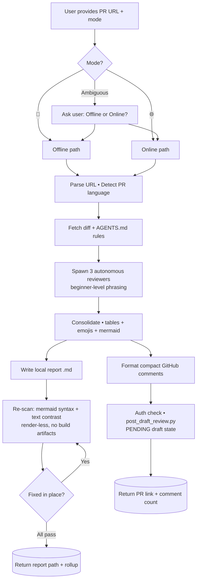

# GitHub PR Reviewer (Offline & Online Modes)

Perform automated, multi-perspective code reviews of a GitHub Pull Request.
This skill runs in **one of two modes**, selected per invocation:

| Mode | What it does | Where findings go |
| --- | --- | --- |
| 📴 **Offline** | Reviews the PR, captures findings in a **local Markdown report file**. Posts **nothing** online. Renders-safe: after writing the file it re-scans every Mermaid diagram to guarantee valid, legible rendering — with zero build artifacts produced. | `PR_<PR_NO>_review.md` in the working directory |
| 🌐 **Online** | Reviews the PR and posts findings as a **pending (draft) code review** on GitHub (visible only to the authenticated user; the maintainer can inspect, edit, and choose when to submit or discard). | GitHub PR via REST API (draft state) |

**Mode selection rules:**
* If the user asks to "save locally", "write a report", "don't post", "offline review", or gives a PR with no explicit posting request → **Offline**.
* If the user asks to "post", "create a draft review", "comment on the PR", "pending comments" → **Online**.
* If ambiguous, ask the user a single clarifying question before doing any work. Never silently default to posting online.

---

## Universal Steps (Run in BOTH Modes)

### Step 1: Parse the PR URL

* Extract `owner`, `repo`, and `pull_number` from the URL: `https://github.com/{owner}/{repo}/pull/{pull_number}`
* For **Online** mode also verify authentication:
  ```bash
  gh auth status || echo "Checking env GITHUB_TOKEN..."
  ```
  If no token or auth is available, ask the user to provide `GITHUB_TOKEN` or run `gh auth login`.

### Step 2: Fetch PR Context (Zero Babysitting)

Before dispatching reviewers, detect the language(s) and fetch all context:

* **Detect the PR's coding language(s)** — scan the diff's file extensions, language signals (`package.json`, `Cargo.toml`, `pyproject.toml`, `CMakeLists.txt`, go.mod, Makefile, shebangs), and the repository's primary language (`gh repo view --json primaryLanguage`). Record the **dominant language(s)** of the change.
* **Adapt to the language ecosystem** — when a finding touches language-specific behavior (e.g., Python GIL / immutability, Rust ownership/borrowing/UB, C++ lifetime/RAII, nullability in C#/Java), the finding must be **explained on the assumption that the reader is a beginner in that specific coding language**:
  * Name the language concept being used (e.g., "this touches *lazy evaluation*") and give a one-sentence plain-English definition the way you'd teach a newcomer.
  * Pair every idiomatic idiom in the diff with a short gloss (e.g., "`yield` — a generator function that produces values one at a time instead of all at once").
  * Avoid piling idioms on jargon; if the reader wouldn't know the term, define it before using it.
  * Suggested fixes must be shown as complete, near-runnable snippets in that language with a one-line explanation of *why* it works for a beginner reader.
* Fetch PR metadata and latest HEAD SHA:
  ```bash
  gh pr view {pull_number} -R {owner}/{repo} --json headRefOid,baseRefOid,title,body,files
  ```
* Fetch the PR diff:
  ```bash
  gh pr diff {pull_number} -R {owner}/{repo}
  ```
* Check repository-specific rules — inspect `AGENTS.md`, `CONTRIBUTING.md`, `.github/` guidelines and extract relevant rules to inject into reviewer prompts.

### Step 3: Launch 3 Read-Only Reviewers Concurrently

Define a read-only `pr_code_reviewer` subagent (write tools disabled, subagent tools disabled) and launch 3 specialized reviewers in parallel with the diff, repo rules, dominant language, and formatting constraints pre-injected — each runs 100% autonomously without prompting the user:

1. `correctness_reviewer` — logic bugs, edge cases, null safety, race conditions, error handling.
2. `architecture_reviewer` — system design, modularity, security vulnerabilities, performance.
3. `guidelines_reviewer` — adherence to `AGENTS.md`/`CONTRIBUTING.md`, test coverage, documentation completeness.

Every finding must carry: **severity** (🔴 Critical / 🟠 Major / 🟡 Minor / 🔵 Info), **file + line**, **plain-language explanation written for a beginner in the PR's language** (per Step 2), and, where applicable, before/after code.

### Step 4: Consolidate Findings

* **Deduplicate**: merge overlapping findings on the same lines.
* **Noise reduction**: drop pedantic / low-confidence remarks unless mandated by `AGENTS.md`.
* **Beginner check**: re-read each finding and rephrase any sentence that assumes prior expertise in the PR's language.
* **Uncertainties / Maintainer notes**: flag anything uncertain about business requirements or domain context with a prominent callout (e.g., `> [!IMPORTANT]` **Maintainer Attention:** ...).

---

## 📴 Offline Mode (No Network Posting — Local Report)

> **Hard rule: the offline mode writes exactly one artifact — the local report file.** Nothing else is uploaded, posted, published, or pushed. No GitHub API calls.

### Step O1: Generate the Local Markdown Report

Write the consolidated review to `PR_<PR_NO>_review.md` in the working directory, where `PR_NO` is the pull request number (e.g., `PR_482_review.md`). The report MUST be visually rich — it is the deliverable the user reads:

* **Headings & hierarchy**: a `#` report title, `##` sections (Overview, Findings by File, Architecture/Flow Analysis, Edge-Case Matrix, Recommendation, Maintainer Notes).
* **Emojis as visual anchors** — use them liberally for severity (🔴🟠🟡🔵), section markers (🚦 flow, 🧠 concept, ⚠️ warning, ✅ good, 🧪 tests, 💡 suggestion), and status checklists (✅ done / ⛔ fail). Emojis are a *visual* signal: keep them meaningful, one per semantic unit, never decorative spam.
* **Tables wherever possible**: findings summary (ID | 🎯 Severity | File | Line | Summary | 💡 Fix), edge-case matrices, before/after behavioral comparisons, per-file impact rollups, checklist of recommendations.
* **Mermaid diagrams wherever possible**: `flowchart` for control flow changes, `sequenceDiagram` for call sequences and concurrency races, `stateDiagram-v2` for state transitions, `classDiagram` for structural changes. Every non-trivial finding that describes *flow* gets a diagram.
* **GFM niceties**: `> [!NOTE]` / `> [!WARNING]` / `> [!IMPORTANT]` alerts, collapsible `<details>` blocks for verbose diffs/context, fenced language-tagged code blocks with *beginner glosses*, inline backticked file paths.
* **Model attribution header** at the top: which model/provider produced the review.

### Step O2: Re-Scan the Written File (Rendering & Legibility Audit)

After the file is written, open it **again** and audit every ` ```mermaid ` block. This audit must be **render-less** — it validates syntax and colors *textually*; it must **not** produce any build artifacts (no SVG/PNG output, no `node_modules`, no HTML, no `npx` cache pollution inside the project — run any parser from a global install or a temp dir outside the repo, and clean it up if used).

**Mermaid syntax audit (per block):**
1. Declare a valid first-line diagram type (`flowchart TD`, `sequenceDiagram`, `stateDiagram-v2`, `classDiagram`, `graph LR`).
2. Balanced brackets/quotes on every node, edge, and message; no stray backticks, `(`, `#`, or unescaped `%` inside node labels (wrap risky labels in `"double quotes"`).
3. Node IDs referenced before definition or used inconsistently (case mismatches) are fixed.
4. Edge/arrow syntax matches the declared diagram type (e.g., no `-->` chains in a `sequenceDiagram`; use `->>` / `-->>`).
5. Optional, if a headless parser is installed globally: run it (e.g., `node -e "..."` with `@mermaid-js/parser` from a **global** path) — purely to get `parse()` errors. If unavailable, the checklist above plus a model self-review is sufficient. **Never** invoke `mmdc` / `mermaid-cli` (that renders HTML/SVG = build artifacts).
6. **Fix the diagram in place** if any check fails; then re-audit only that block.

**Mermaid legibility audit (per block):**
1. **Text contrast**: any `classDef` / `style` / `linkStyle` that sets a **fill** color must also set an explicit **text** `color:` chosen for contrast — never white text on a light/bright fill (e.g., ❌ `classDef ok fill:#c8f7c5` with default white text; ✅ `classDef ok fill:#c8f7c5,stroke:#2e7d32,color:#1b5e20`).
2. Prefer **dark saturated fills with light text** (e.g., `fill:#2e7d32,color:#ffffff`) or **light desaturated fills with dark text** — and *always declare* the text color explicitly rather than relying on Mermaid/theme defaults.
3. Label lengths: keep node labels short enough to render without overlap in typical widths; move long explanations to the surrounding Markdown text.
4. Verify emoji used *inside* Mermaid node labels render as text (fine in modern renderers) — no reliance on custom fonts or theme variables.

If the audit changes the file, record a one-line "🔍 Report self-audit: N diagram(s) fixed for syntax/contrast" note in the report's footer.

### Step O3: Present Results to User

* Path to the report file (clickable).
* Quick rollup: total findings by severity (table), top 3 issues, and whether the diagrams passed the audit (✅ syntax / ✅ contrast).

---

## 🌐 Online Mode (Draft Review Posted to GitHub)

### Step N1: Format for GitHub

Apply the same visual-aid approach as the offline report (tables, emojis, mermaid, GFM alerts, collapsible details) — but sized for PR comments:
* Each **inline comment** stays compact: severity emoji + 1-3 sentence beginner-level explanation + optional tiny table or a single focused snippet; reserve big diagrams for the **overall summary**.
* The **summary** carries the overview table, primary Mermaid flows, and Maintainer Notes callouts.
* Keep code suggestions as `suggestion` blocks where valid on the diff line.

### Step N2: Post the Pending (Draft) Review

Save consolidated comments to a temporary JSON file and run the draft review helper:

```bash
python3 skills/github-draft-reviewer/scripts/post_draft_review.py \
  --pr "https://github.com/{owner}/{repo}/pull/{pull_number}" \
  --commit-id "{HEAD_COMMIT_SHA}" \
  --summary "Code Review Summary:\n\n* ..." \
  --comments-file "/path/to/comments.json" \
  --model "MODEL_NAME_OR_PROVIDER"
```

The script calls `POST /repos/{owner}/{repo}/pulls/{pull_number}/reviews` **without** an `event` parameter, creating the review in `PENDING` (draft) state — visible only to the authenticated user until they submit or discard it. The script pre-validates diff hunks and auto-aligns line numbers.

### Step N3: Present Results to User

* Direct link: `https://github.com/{owner}/{repo}/pull/{pull_number}/files`
* Summary: total draft comments posted, key files flagged, maintainer notes needing a human decision.

---

## Workflow Overview



---

## References and Helper Scripts

* Helper Script: [scripts/post_draft_review.py](scripts/post_draft_review.py) — posts a PENDING GitHub draft review (online mode only).
* Reviewer Prompts and Consolidation Guide: [references/reviewer_prompts.md](references/reviewer_prompts.md)
* GitHub REST API Specification: [references/github_api.md](references/github_api.md)
