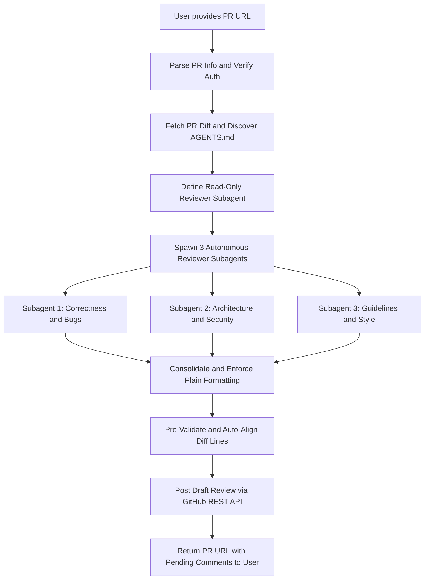

# GitHub Draft PR Reviewer

Perform automated, multi-perspective code reviews on GitHub Pull Requests and post findings as pending (draft) reviews.

Pending reviews remain in draft mode on GitHub, visible only to the authenticated user. The maintainer can open the PR in their browser, inspect and edit the draft comments, and choose when to submit (as Comment, Approve, or Request Changes) or discard them.

---

## Formatting Constraints (Mandatory)

All generated review summaries, inline comments, and subagent outputs must follow these strict formatting rules:
* Do not use emojis anywhere.
* Do not use bold, italic, or underline fonts (avoid double asterisks, single asterisks around words, underscores for italics, or HTML underline tags).
* Do not use numbered lists (avoid 1., 2., 3.).
* Only use asterisk bullet points (*) for lists and items.
* Code blocks (such as ```suggestion or ```cpp) and backticked identifiers (`path/to/file`) are permitted.

---

## Prerequisites and Authentication

This skill requires GitHub access via either:
* Environment Variable: `GITHUB_TOKEN` or `GH_TOKEN` set with a GitHub Personal Access Token (PAT) having `repo` or `pull_requests: write` permissions.
* GitHub CLI: Active authentication via `gh auth login` / `gh auth status`.

---

## Workflow Steps



### Step 1: Parse PR URL and Verify Authentication

* Extract `owner`, `repo`, and `pull_number` from the user's PR URL:
  * Format: `https://github.com/{owner}/{repo}/pull/{pull_number}`
* Check GitHub authentication status:
  ```bash
  gh auth status || echo "Checking env GITHUB_TOKEN..."
  ```
  If no token or auth is available, ask the user to provide their `GITHUB_TOKEN` or run `gh auth login`.

### Step 2: Fetch PR Metadata, Diff, and Repository Rules (Zero Babysitting)

The orchestrator fetches all needed context upfront so reviewer subagents do not need to execute shell commands:
* Fetch PR details and the latest HEAD commit SHA:
  ```bash
  gh pr view {pull_number} -R {owner}/{repo} --json headRefOid,baseRefOid,title,body,files
  ```
* Fetch the PR diff:
  ```bash
  gh pr diff {pull_number} -R {owner}/{repo}
  ```
* Check the repository for repository-specific rules:
  * Inspect `AGENTS.md`, `CONTRIBUTING.md`, or `.github/` guidelines.
  * Extract relevant rules to pass to the reviewer subagents.

### Step 3: Define Read-Only Subagent and Launch 3 Reviewers Concurrently

To prevent subagents from prompting for tool/command execution approvals:
* Define a read-only `pr_code_reviewer` subagent type using `define_subagent`:
  * `enable_write_tools: false`
  * `enable_subagent_tools: false`
* Launch 3 specialized subagents in parallel with the diff, rules, and formatting constraints pre-injected into their prompt:
  * `correctness_reviewer`: Logic bugs, edge cases, null safety, race conditions, error handling.
  * `architecture_reviewer`: System design, modularity, security vulnerabilities, performance.
  * `guidelines_reviewer`: Adherence to `AGENTS.md` / `CONTRIBUTING.md`, test coverage, documentation completeness.

Each subagent runs 100% autonomously without prompting the user for command execution.

### Step 4: Consolidate Findings and Enforce Formatting Rules

Merge findings from the 3 subagents:
* Deduplicate: Merge overlapping findings on the same code lines.
* Noise Reduction: Omit pedantic or low-confidence remarks unless mandated by `AGENTS.md`.
* Formatting Enforcement:
  * Remove all emojis.
  * Remove all bold, italic, or underline fonts.
  * Convert any numbered lists to asterisk bullet points (*).
* Highlight Uncertainties / Maintainer Notes:
  * For points where the agents are uncertain about business requirements or domain context, note it with a plain text prefix: `Maintainer Attention: ...`
* Compile a top-level review summary with model attribution header.

### Step 5: Pre-Validate Lines and Post Pending (Draft) Review to GitHub

Save the consolidated comments to a temporary JSON file and run the draft review helper script:

```bash
python3 ~/.gemini/config/skills/github-draft-reviewer/scripts/post_draft_review.py \
  --pr "https://github.com/{owner}/{repo}/pull/{pull_number}" \
  --commit-id "{HEAD_COMMIT_SHA}" \
  --summary "Code Review Summary:\n\n* ..." \
  --comments-file "/path/to/comments.json" \
  --model "MODEL_NAME_OR_PROVIDER"
```

The helper script calls GitHub's `POST /repos/{owner}/{repo}/pulls/{pull_number}/reviews` endpoint without specifying an `event` parameter. This creates the review in `PENDING` (draft) state.

The script automatically pre-validates diff hunks and auto-aligns line numbers if needed before posting.

### Step 6: Present Results to User

After creating the draft review, output:
* Direct clickable link to the PR files view: `https://github.com/{owner}/{repo}/pull/{pull_number}/files`
* Summary of the review:
  * Total draft comments posted
  * Key areas / files flagged
  * Specific maintainer notes that require human decision-making

---

## References and Helper Scripts

* Helper Script: [post_draft_review.py](file:///usr/local/google/home/aaronchong/.gemini/config/skills/github-draft-reviewer/scripts/post_draft_review.py)
* Reviewer Prompts and Consolidation Guide: [reviewer_prompts.md](file:///usr/local/google/home/aaronchong/.gemini/config/skills/github-draft-reviewer/references/reviewer_prompts.md)
* GitHub REST API Specification: [github_api.md](file:///usr/local/google/home/aaronchong/.gemini/config/skills/github-draft-reviewer/references/github_api.md)
