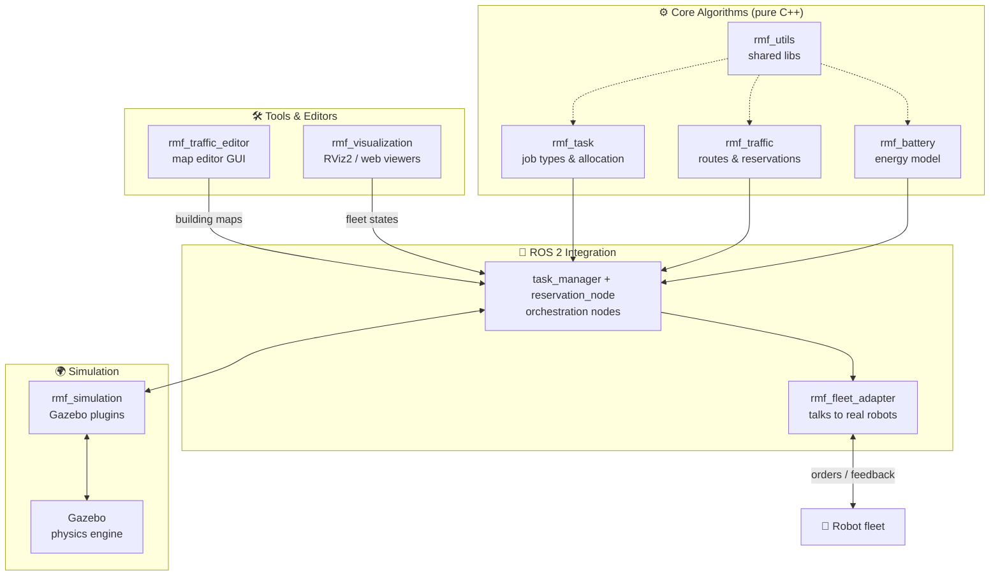
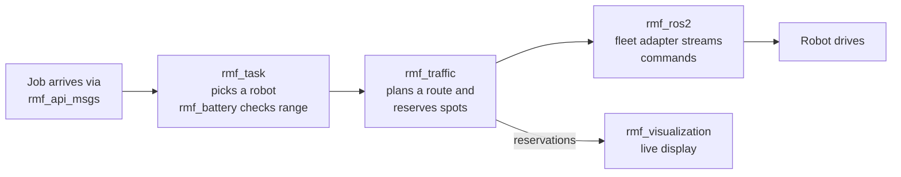
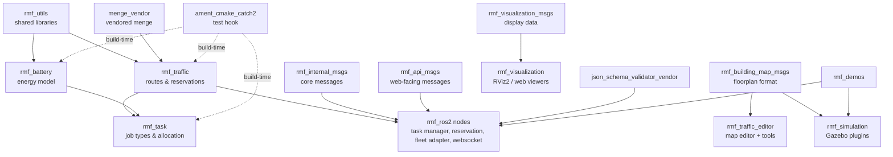

## Open-RMF Architecture

Open-RMF (Robotic Middleware Framework) is a fleet orchestration and traffic deconfliction stack for mobile robots in buildings. It is built on top of [the `rmf.repos` manifest](https://github.com/open-rmf/rmf/blob/main/rmf.repos) and split into three layers: **core algorithms** (pure C++ libraries), **ROS 2 integration** (nodes that run the algorithms as a live system), and **tools** (editors, simulation, and visualization).

### Components at a Glance

| Repository | One-line job |
|---|---|
| [rmf_traffic](https://github.com/open-rmf/rmf_traffic) | the "air traffic control" — plans routes and negotiates time/spot reservations so robots never collide |
| [rmf_task](https://github.com/open-rmf/rmf_task) | the "order desk" — defines job types (deliver, charge, dock) and allocates them to robots |
| [rmf_battery](https://github.com/open-rmf/rmf_battery) | the "fuel gauge" — models battery energy so charging gets scheduled before robots run empty |
| [rmf_internal_msgs](https://github.com/open-rmf/rmf_internal_msgs) | the "vocabulary" — core messages for fleets, tasks, doors, lifts, reservations, etc. |
| [rmf_building_map_msgs](https://github.com/open-rmf/rmf_building_map_msgs) | the "floorplan format" — messages describing building layouts and navigation graphs |
| [rmf_api_msgs](https://github.com/open-rmf/rmf_api_msgs) | the "front desk API" — messages that bridge C++ backend to web frontends |
| [rmf_ros2](https://github.com/open-rmf/rmf_ros2) | the "conductor" — runs traffic, task, reservation, and fleet-adapter nodes on ROS 2 and talks to real robots |
| [rmf_demos](https://github.com/open-rmf/rmf_demos) | the "sample office" — example fleets, Gazebo worlds, and launch files to try everything |
| [rmf_simulation](https://github.com/open-rmf/rmf_simulation) | the "physics driver" — Gazebo plugins that move simulated robots from RMF plans |
| [rmf_traffic_editor](https://github.com/open-rmf/rmf_traffic_editor) | the "map editor" — GUI + CLI to annotate floorplans into building maps |
| [rmf_visualization](https://github.com/open-rmf/rmf_visualization) | the "mission control" — RViz2 / web tools to watch fleets, navgraphs, and reservations live |
| [rmf_visualization_msgs](https://github.com/open-rmf/rmf_visualization_msgs) | the "display data" — messages carrying what the visualizers render |
| [rmf_utils](https://github.com/open-rmf/rmf_utils) | the "toolbox" — shared utility libraries every other repo depends on |
| [ament_cmake_catch2](https://github.com/open-rmf/ament_cmake_catch2) | the "unit-test hook" — CMake macros for Catch2 tests in ament packages |
| [menge_vendor](https://github.com/open-rmf/menge_vendor) | "crowd engine" — vendored menge path-planning for pedestrians |
| [nlohmann_json_schema_validator_vendor](https://github.com/open-rmf/nlohmann_json_schema_validator_vendor) | "schema police" — vendored json-schema-validator |
| [pybind11_json_vendor](https://github.com/open-rmf/pybind11_json_vendor) | "JSON bridge" — pybind11 JSON binding |

### System View

### How a Job Flows

### Repository Dependency Skeleton

Only the main structural relationships, taken from the `package.xml` files in [the source tree](https://github.com/open-rmf/rmf/tree/main/src):

> **Notes**
> - The core repos (`rmf_traffic`, `rmf_task`, `rmf_battery`, `rmf_utils`) are **pure C++ libraries** — no ROS dependency — so they are testable and reusable outside any live system.
> - [`rmf_ros2`](https://github.com/open-rmf/rmf_ros2) packages (`rmf_task_ros2`, `rmf_traffic_ros2`, `rmf_reservation_node`, `rmf_fleet_adapter`, `rmf_websocket`, `rmf_charging_schedule`) turn those libraries into a live distributed system on ROS 2. See its [integration diagram](https://github.com/open-rmf/rmf_ros2/blob/main/docs/rmf_core_integration_diagram.png).
> - `rmf_demos` is **built from source** and wires the full chain together: [`rmf_demos_gz`](https://github.com/open-rmf/rmf_demos/blob/main/rmf_demos_gz) (worlds), [`rmf_demos_fleet_adapter`](https://github.com/open-rmf/rmf_demos/blob/main/rmf_demos_fleet_adapter) (fake robots), [`rmf_demos_tasks`](https://github.com/open-rmf/rmf_demos/blob/main/rmf_demos_tasks) (sample jobs).
> - **Simulation:** `rmf_simulation`'s Gazebo plugins (`rmf_building_sim_gz_plugins`, `rmf_robot_sim_gz_plugins`) apply the traffic plans to simulated bodies; `rmf_demos` provides the ready-made Gazebo worlds.
> - **Map pipeline:** `rmf_traffic_editor`'s GUI (Python) annotates floorplans → `rmf_building_map_tools` converts them into `rmf_building_map_msgs` / Gazebo SDF, and `building_map_server` serves them at runtime.
> - **Vendor repos** (`thirdparty/*`) just make third-party libraries buildable via colcon; they carry no RMF logic.
> - [ament_cmake_catch2](https://github.com/open-rmf/ament_cmake_catch2) is a build helper, not a runtime dependency of any RMF component.

### Packages

There are **56** colcon packages across the 17 repositories, grouped by the repository they come from. A repository may contain several packages.

| # | Repository | Package | Purpose |
|---|---|---|---|
| 1 | rmf/rmf_api_msgs | `rmf_api_msgs` | Web-facing API messages that bridge the C++ backend to frontends |
| 2 | rmf/rmf_battery | `rmf_battery` | Battery energy-modeling core library |
| 3 | rmf/rmf_building_map_msgs | `rmf_building_map_msgs` | Messages describing building layouts and navigation graphs |
| 4 | rmf/rmf_internal_msgs | `rmf_charger_msgs` | Messages for chargers and charging requests |
| 5 | rmf/rmf_internal_msgs | `rmf_dispenser_msgs` | Messages for dispensers (e.g. coffee/supply vending) |
| 6 | rmf/rmf_internal_msgs | `rmf_door_msgs` | Messages for door open/close requests and states |
| 7 | rmf/rmf_internal_msgs | `rmf_fleet_msgs` | Messages describing fleets, robots, and their states |
| 8 | rmf/rmf_internal_msgs | `rmf_ingestor_msgs` | Messages for ingestors (pick-up points) |
| 9 | rmf/rmf_internal_msgs | `rmf_lift_msgs` | Messages for lift (elevator) requests and states |
| 10 | rmf/rmf_internal_msgs | `rmf_obstacle_msgs` | Messages for dynamic obstacles and avoidance |
| 11 | rmf/rmf_internal_msgs | `rmf_reservation_msgs` | Messages for route/spot time reservations |
| 12 | rmf/rmf_internal_msgs | `rmf_scheduler_msgs` | Messages for the task scheduler |
| 13 | rmf/rmf_internal_msgs | `rmf_site_map_msgs` | Messages for the site-level (whole-campus) map |
| 14 | rmf/rmf_internal_msgs | `rmf_task_msgs` | Messages for task types and task states |
| 15 | rmf/rmf_internal_msgs | `rmf_traffic_msgs` | Messages for traffic plans, routes, and profiles |
| 16 | rmf/rmf_internal_msgs | `rmf_workcell_msgs` | Messages for shared workcell (station) reservations |
| 17 | rmf/rmf_internal_msgs | `rmf_zone_msgs` | Messages for zone (geographic area) reservations |
| 18 | rmf/rmf_ros2 | `rmf_charging_schedule` | ROS 2 node that schedules robot charging |
| 19 | rmf/rmf_ros2 | `rmf_fleet_adapter` | Base node bridging RMF core to a specific robot fleet |
| 20 | rmf/rmf_ros2 | `rmf_fleet_adapter_python` | Python bindings for building fleet adapters |
| 21 | rmf/rmf_ros2 | `rmf_reservation_node` | Node managing route/spot reservations |
| 22 | rmf/rmf_ros2 | `rmf_task_ros2` | Node running the task manager and scheduler |
| 23 | rmf/rmf_ros2 | `rmf_traffic_ros2` | Node running the traffic controller |
| 24 | rmf/rmf_ros2 | `rmf_websocket` | Websocket bridge exposing the API to web clients |
| 25 | rmf/rmf_simulation | `rmf_building_sim_gz_plugins` | Gazebo plugins for simulating doors/lifts/obstacles |
| 26 | rmf/rmf_simulation | `rmf_robot_sim_common` | Shared code for simulated robot drivers |
| 27 | rmf/rmf_simulation | `rmf_robot_sim_gz_plugins` | Gazebo plugins that drive simulated robots |
| 28 | rmf/rmf_task | `rmf_task` | Core library defining task types and task allocation |
| 29 | rmf/rmf_task | `rmf_task_sequence` | Core library for multi-stage task sequences |
| 30 | rmf/rmf_traffic | `rmf_traffic` | Core traffic library (routing, reservations, profiles) |
| 31 | rmf/rmf_traffic | `rmf_traffic_examples` | Example maps and test data for rmf_traffic |
| 32 | rmf/rmf_traffic_editor | `rmf_building_map_tools` | CLI tools converting maps into building-map msgs / SDF |
| 33 | rmf/rmf_traffic_editor | `rmf_traffic_editor` | The map-editor GUI itself |
| 34 | rmf/rmf_traffic_editor | `rmf_traffic_editor_assets` | Static assets (icons, images) for the editor GUI |
| 35 | rmf/rmf_traffic_editor | `rmf_traffic_editor_test_maps` | Test fixtures/maps used by the editor tests |
| 36 | rmf/rmf_utils | `rmf_utils` | Shared generic utility libraries (geometry, time, etc.) |
| 37 | rmf/rmf_visualization | `rmf_visualization` | Core data models for visualization panels |
| 38 | rmf/rmf_visualization | `rmf_visualization_building_systems` | Panel for doors/lifts/chargers/etc. states |
| 39 | rmf/rmf_visualization | `rmf_visualization_fleet_states` | Panel for fleet/robot states |
| 40 | rmf/rmf_visualization | `rmf_visualization_floorplans` | Panel showing building floorplans |
| 41 | rmf/rmf_visualization | `rmf_visualization_navgraphs` | Panel showing navigation graphs |
| 42 | rmf/rmf_visualization | `rmf_visualization_obstacles` | Panel showing dynamic obstacles |
| 43 | rmf/rmf_visualization | `rmf_visualization_rviz2_plugins` | RViz2 plugins for the visualization panels |
| 44 | rmf/rmf_visualization | `rmf_visualization_schedule` | Panel showing the task schedule |
| 45 | rmf/rmf_visualization_msgs | `rmf_visualization_msgs` | Messages carrying visualization data |
| 46 | demonstrations/rmf_demos | `rmf_demos_assets` | Gazebo/fleet demo assets and models |
| 47 | demonstrations/rmf_demos | `rmf_demos_bridges` | Demo robots/bridges for simulated fleets |
| 48 | demonstrations/rmf_demos | `rmf_demos_fleet_adapter` | Demo fleet adapters for fake robots |
| 49 | demonstrations/rmf_demos | `rmf_demos_gz` | Gazebo worlds and launch files for the demos |
| 50 | demonstrations/rmf_demos | `rmf_demos_maps` | Map data used by the demo environments |
| 51 | demonstrations/rmf_demos | `rmf_demos` | Top-level demo package wiring everything together |
| 52 | demonstrations/rmf_demos | `rmf_demos_tasks` | Sample tasks/jobs to run in the demos |
| 53 | rmf/ament_cmake_catch2 | `ament_cmake_catch2` | CMake macros for Catch2 unit tests in ament packages |
| 54 | thirdparty/menge_vendor | `menge_vendor` | Vendored menge crowd/planning library |
| 55 | thirdparty/nlohmann_json_schema_validator_vendor | `nlohmann_json_schema_validator_vendor` | Vendored json-schema-validator |
| 56 | thirdparty/pybind11_json_vendor | `pybind11_json_vendor` | pybind11 JSON bindings |
